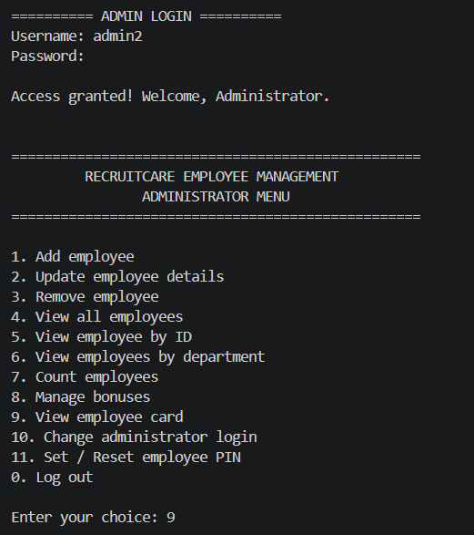
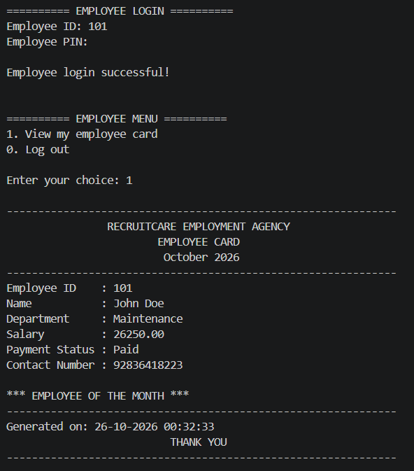

# Employee Management System

**A Class XII Computer Science project (2020–2021), preserved and restored in 2026.**

Employee Management System is a menu-driven Python application backed by MySQL. It was originally developed as a school Computer Science project, then revisited in 2026 to preserve the original work and make the application easier to run, maintain, and test.

The repository contains **two distinct versions**: the unchanged 2021 source and project report, and a separate 2026 restoration. The restored code is **not** presented as the original 2021 implementation.

## Features

### Administrator

- Add, view, update, and remove employee records
- Find an employee by ID or filter employees by department
- Count employee records
- Update salaries, payment status, department, name, and contact details
- Set, view, or remove **Employee of the Month**
- Apply percentage-based salary increases
- Display formatted employee cards
- Change administrator login credentials
- Set or reset employee login PINs

### Employee

- Sign in with an employee ID and PIN assigned by an administrator
- View their **own** employee card
- Log out

The seven departments retained from the original project are **Transport, Office, Cleaning, Maintenance, Security, Sales, and Accounts**.

## Screenshots

Screenshots from the **restored 2026 application** (not the original 2021 submission):

### Administrator menu



### Employee card



The original 2021 interface and its screenshots remain available in the project report under [`original-2021/`](original-2021/).

## Project history

| | Original project | Restored edition |
|---|---|---|
| Period | 2020–2021 | 2026 |
| Context | Class XII Computer Science | Personal portfolio restoration |
| Interface | Python IDLE-based text menus | Standard terminal-based menus |
| Database | MySQL | MySQL |
| Credentials | Hardcoded demonstration credentials | Local configuration, hashed administrator password and employee PINs |
| Codebase | Original single-file source | Separated into focused Python modules |
| SQL | Formatted query strings | Parameterized queries for record values |
| Testing | Documented manual outputs | Manual checks and `unittest` smoke tests |

The historical submission is preserved as-is under [`original-2021/`](original-2021/). It is included for archival purposes and **should not be used as the current application**.

## Technology

- **Python 3** — application logic and command-line interface
- **MySQL Server** — persistent employee and login records
- **mysql-connector-python** — Python–MySQL connectivity
- **python-dotenv** — local database configuration
- **tabulate** — formatted employee tables
- **unittest** — automated checks

The restoration was developed and tested locally with Python 3.10 and MySQL Server 26.10.0. Other combinations have not been exhaustively tested.

## Repository structure

```text
employee-management-system/
├── original-2021/           # Original .py file and 2020–2021 PDF report
├── restored-2026/
│   ├── main.py              # Login screens and main menus
│   ├── database.py          # MySQL connection
│   ├── employees.py         # Add, view, and remove records
│   ├── management.py        # Updates and department filtering
│   ├── bonuses.py           # Salary bonuses and employee recognition
│   ├── cards.py             # Employee cards
│   ├── auth.py              # Administrator authentication
│   └── employee_auth.py     # Employee PIN authentication
├── database/
│   ├── schema.sql           # Database and table definitions
│   └── sample_data.sql      # Fictional example employees
├── tests/
│   └── test_system.py       # Automated smoke tests
├── screenshots/
│   ├── admin-menu.png       # Restored administrator menu
│   └── employee-card.png    # Restored employee card
├── .env.example             # Database configuration template
├── .gitignore
├── requirements.txt
└── test_connection.py       # Database connectivity check
```

## Getting started

These instructions assume **Windows**, **Git Bash**, Python 3, and a running local MySQL Server. **MySQL Workbench is not required.**

### 1. Clone the repository

```bash
git clone https://github.com/ItsJensen316/Employee-Management-System.git
cd Employee-Management-System
```

> Replace the placeholder with the real GitHub repository URL after creating the repository.

### 2. Create a Python environment

```bash
python -m venv .venv
source .venv/Scripts/activate
python -m pip install -r requirements.txt
```

In PowerShell instead of Git Bash, activate the environment with `./.venv/Scripts/Activate.ps1`.

### 3. Create the MySQL database and tables

From the project root in **Git Bash**, run:

```bash
mysql -u root -p < database/schema.sql
```

Enter the MySQL root password when prompted. This creates the `EmpManagement` database and its `employee` and `employee_login` tables if they do not already exist.

### 4. Create a database user for the application

Log into MySQL as root:

```bash
mysql -u root -p
```

Run the following SQL, **replacing the example password** with a strong, unique one:

```sql
CREATE USER 'employee_app'@'localhost'
IDENTIFIED BY 'REPLACE_WITH_A_STRONG_PASSWORD';

GRANT SELECT, INSERT, UPDATE, DELETE
ON EmpManagement.*
TO 'employee_app'@'localhost';
```

If that user already exists, do not run `CREATE USER` again. Instead, use your existing account or deliberately update its password.

### 5. Set up local environment variables

In Git Bash:

```bash
cp .env.example .env
```

Edit `.env` with your local settings:

```dotenv
DB_HOST=localhost
DB_PORT=3306
DB_NAME=EmpManagement
DB_USER=employee_app
DB_PASSWORD=YOUR_DATABASE_USER_PASSWORD
```

**Never commit `.env`** or share your real passwords. The repository includes `.env.example` as a public template.

### 6. Optionally load fictional sample employees

From the project root:

```bash
mysql -u root -p < database/sample_data.sql
```

This is optional. It adds seven fictional employee examples, one per department. Existing rows with matching IDs are not replaced; run the script only on a database you're comfortable using for demonstrations.

### 7. Verify and launch

```bash
python test_connection.py
python restored-2026/main.py
```

On first launch, create an administrator username and password. Then sign in through **Administrator Login**. To try **Employee Login**, first use the administrator menu to set a PIN for an existing employee.

## Running tests

```bash
python -m unittest discover -s tests -p 'test_*.py' -v
```

The included tests check administrator password hashing, employee PIN hashing, MySQL connectivity, table structure, and login-record integrity. They are **smoke tests**, not a full end-to-end or security test suite. The database must be running and the `.env` configuration must be valid.

## Security and scope

This is a **local educational and portfolio application**, not production HR software. The restored version improves on the original by using parameterized SQL values, a dedicated database user, password/PIN hashing, and role-specific menus. It has not undergone a professional security audit; login attempt limits are session-level and other production protections are outside the project's scope.

The following local files are intentionally excluded from version control:

- `.env` — database credentials
- `.venv/` — Python virtual environment
- `restored-2026/.admin_auth.json` — local administrator credential verifier
- Python bytecode and cache directories

**Historical note:** The original 2021 script is preserved as an artifact and may contain old demonstration credentials and agency-style contact details. Do not treat those as current credentials or operational contact information.